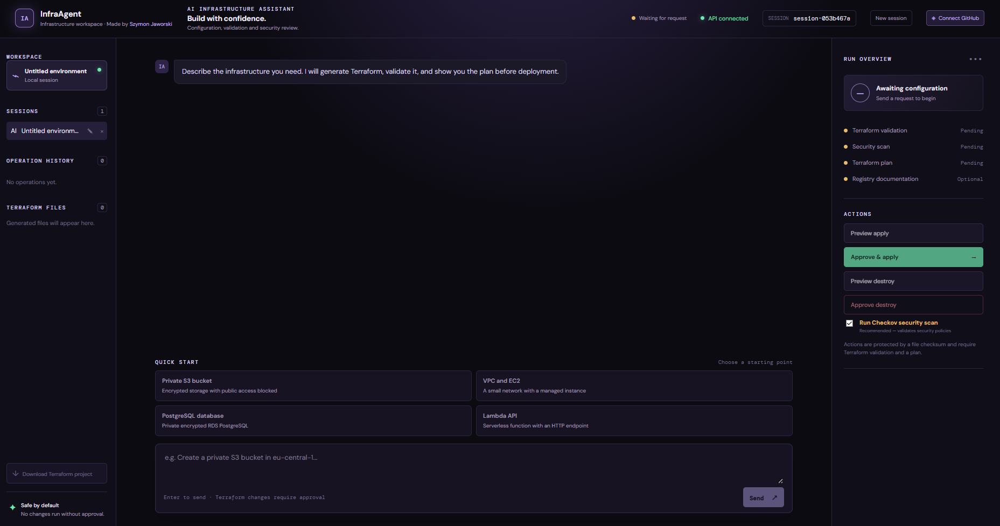
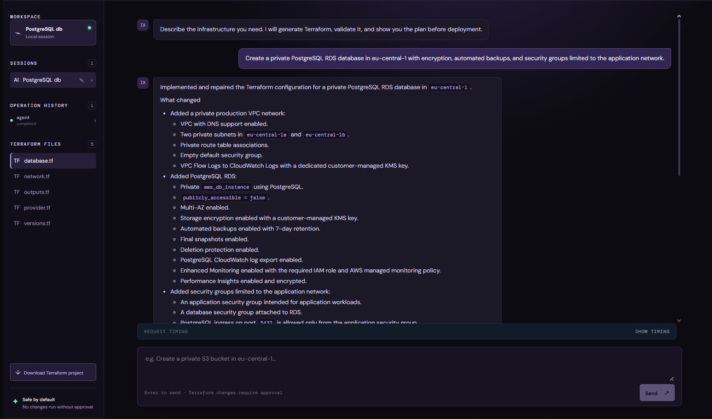
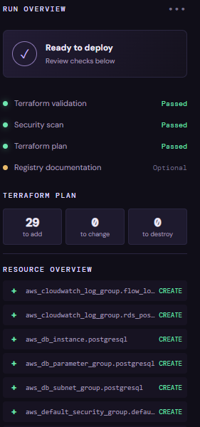
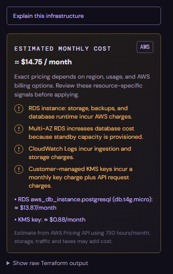
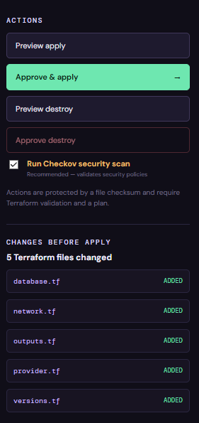

<div align="center">

# InfraAgent

**Describe your AWS infrastructure in plain English. Get validated, security-scanned, cost-estimated Terraform, and deploy it only after an explicit human approval.**

[](LICENSE)
[](pyproject.toml)
[](app/)
[](frontend/)
[](https://www.terraform.io/)



</div>

---

## Table of contents

- [Why InfraAgent](#why-infraagent)
- [How it works](#how-it-works)
- [Screenshots](#screenshots)
- [Quick start](#quick-start)
- [Requirements](#requirements)
- [Configuration](#configuration)
- [Safety and approval model](#safety-and-approval-model)
- [Terraform and security rules](#terraform-and-security-rules)
- [Cost estimation](#cost-estimation)
- [Architecture](#architecture)
- [Provider cache and Terraform MCP](#provider-cache-and-terraform-mcp)
- [GitHub repository planning](#github-repository-planning)
- [API overview](#api-overview)
- [Testing and evaluations](#testing-and-evaluations)
- [Roadmap](#roadmap)
- [Contributing](#contributing)
- [Author](#author)
- [License](#license)

---

## Why InfraAgent

Most "LLM writes Terraform" tools stop at generating code. InfraAgent is built around the part that actually matters in infrastructure work: **trust**.

- **The agent can write, but it can never deploy.** The chat agent has no `apply` or `destroy` tool. Those are separate API operations, gated by a plan receipt and an explicit approval request.
- **Every change is reviewed deterministically.** After each write, the code goes through `terraform fmt → init → validate → Checkov → plan`, and failures trigger bounded repair passes.
- **Approvals are bound to what you reviewed.** An approval artifact is tied to the session, a SHA-256 digest of all `.tf` files, the plan output, and a 30-minute TTL. Change a single file and the approval is void.
- **Behavior is measured, not assumed.** A local eval suite scores the actual tool trace (read before write, review after write, no apply/destroy calls, no secrets).

## How it works

```
User request
    ↓
Planner Agent        read-only context analysis
    ↓
Builder Agent        bounded ReAct tool loop
    ↓
Terraform fmt → init → validate → Checkov → plan
    ↓
Cost estimate and plan review
    ↓
Preview apply → explicit approval → apply
```

### Main capabilities

- Natural-language Terraform generation for AWS.
- Per-session Terraform workspaces and persistent conversation history.
- Planner, Builder, and deterministic Reviewer separation.
- ReAct tools: `read_workspace`, `write_tf`, and `check_infrastructure`.
- Read-before-write enforcement for every agent turn.
- Terraform validation, Checkov security scanning, and AWS plan generation.
- Structured review results with stage, category, retryability, and suggested action.
- Bounded repair passes when validation or security checks fail.
- Terraform Registry documentation through the Terraform MCP server.
- AWS Pricing API estimates and cost warnings for S3, KMS, RDS, EC2, NAT Gateway, and CloudWatch Logs.
- Apply preview, explicit apply approval, destroy preview, and destroy approval.
- Live Terraform output, persistent operation history, and operation cancellation.
- WebSocket progress with Server-Sent Events fallback.
- Local evaluation suite with behavioral tool-trace scoring.

## Screenshots

<!-- TODO: drop your screenshots into docs/images/ using the file names below (or change the paths). -->

| Chat and session history | Terraform file and diff inspector |
|---|---|
|  |  |

| Plan, cost and security panels | Apply / destroy with live status |
|---|---|
|  |  |

## Quick start

```bash
# 1. Clone
git clone https://github.com/SzymonJawors/infraAgent.git
cd infraAgent

# 2. Configure
cp .env.example .env        # then fill in OPENAI_API_KEY, AWS_REGION, ...

# 3. Backend
python -m venv .venv
source .venv/bin/activate   # Windows (PowerShell): .\.venv\Scripts\Activate.ps1
pip install -r requirements.txt
uvicorn app.main:app --reload

# 4. Frontend (in a second terminal)
cd frontend
npm install
npm run dev
```

- API: `http://127.0.0.1:8000`
- Frontend: the Vite dev server starts on its configured local port and proxies API requests to the backend.

> Terraform validation works without AWS credentials. In that case the plan step is skipped and clearly reported as not sent to AWS.

<!-- TODO: add a "Run with Docker" section here once the Dockerfile usage is finalized (build/run commands and exposed ports). -->

## Requirements

| Requirement | Needed for |
|---|---|
| Python 3.14 | Backend |
| Node.js and npm | Frontend |
| Terraform on `PATH` | Validation, plan, apply, destroy |
| Checkov | Security scanning |
| OpenAI API key | The agent |
| AWS credentials | AWS `plan`, `apply` and `destroy` (optional for validation only) |

## Configuration

Copy `.env.example` to `.env` and set the values you need:

```env
OPENAI_API_KEY=
OPENAI_MODEL=gpt-5.4-mini
AWS_ACCESS_KEY_ID=
AWS_SECRET_ACCESS_KEY=
AWS_SESSION_TOKEN=
AWS_REGION=eu-central-1
TERRAFORM_MCP_URL=
BRAINTRUST_API_KEY=
```

For the optional GitHub integration, also set `GITHUB_CLIENT_ID`, `GITHUB_CLIENT_SECRET`, `GITHUB_REDIRECT_URI` and `GITHUB_FRONTEND_URL` (see [GitHub repository planning](#github-repository-planning)).

Credentials are passed only to child processes that need them. They are never written to Terraform files or sent to the model.

## Safety and approval model

The agent can generate and review Terraform, but chat messages cannot deploy or destroy infrastructure.

### Apply flow

1. The agent generates or updates Terraform.
2. Terraform validation, Checkov and plan must pass.
3. The backend stores an apply approval artifact.
4. **Preview apply** displays the stored plan without calling AWS to apply changes.
5. **Approve & apply** re-checks the artifact and starts `terraform apply`.

The artifact contains:

- the session id,
- a SHA-256 digest of all `.tf` files,
- the plan output,
- the operation kind,
- the creation timestamp.

It expires after 30 minutes, and any Terraform file change invalidates it. A missing, expired or mismatched artifact returns `409` and Terraform is not started.

### Destroy flow

1. **Preview destroy** runs `terraform plan -destroy` and changes nothing.
2. A separate destroy approval artifact is stored.
3. **Approve destroy** verifies the artifact and starts `terraform destroy`.
4. A protected EC2 instance is prepared for approved destruction when necessary.

Apply and destroy run asynchronously. Their output is persisted and can be cancelled from the UI. A cancelled operation is reported as `cancelled`, not `failed`.

## Terraform and security rules

The agent:

- never writes AWS credentials, passwords or placeholder secrets to Terraform;
- rejects `local-exec`, `remote-exec`, provisioners and `data "external"`;
- requires a confirmed AWS region;
- avoids guessing region-specific RDS engine versions;
- requires two Availability Zones for RDS subnet groups;
- uses private networking, encryption and blocked S3 public access where relevant;
- does not hardcode region-specific AMI ids;
- avoids `0.0.0.0/0` unless explicitly requested;
- keeps `apply` and `destroy` outside the chat generation path.

Checkov findings accepted by default are optional scope items such as S3 access logging, lifecycle retention, cross-region replication and event notifications. All other actionable findings block approval.

## Cost estimation

The plan panel reports:

- AWS Pricing API estimates where a reliable lookup is available,
- per-resource pricing items,
- warnings for usage-based or incomplete costs,
- an explicit partial/unavailable status when AWS pricing data cannot be resolved.

The estimate assumes 730 hours per month for hourly resources. It is **not an AWS bill**: storage, requests, data transfer, backups, taxes and account-specific discounts may change the final amount.

## Architecture

```
FastAPI
├── API routes and Pydantic contracts
├── Session and operation persistence (SQLite)
└── InfraAgent coordinator
    ├── PlannerAgent       read-only analysis
    ├── AgentCore          shared sync/async tool-loop runner
    ├── BuilderAgent       Terraform writes and bounded repairs
    └── ReviewAgent        fmt, init, validate, Checkov, plan

React + Vite frontend
├── Chat and session history
├── Terraform file and diff inspector
├── Plan, cost and security panels
└── Apply/destroy controls with live operation status
```

### Repository structure

| Path | Purpose |
|---|---|
| `app/api/` | FastAPI routes and request/response schemas |
| `app/core/` | Configuration and application infrastructure |
| `app/services/agent.py` | Agent coordinator and Terraform tool definitions |
| `app/services/agent_core.py` | Shared Builder/ReAct execution contract |
| `app/services/planner.py` | Read-only planning and context analysis |
| `app/services/builder.py` | Write-capable agent and repair loop |
| `app/services/reviewer.py` | Deterministic validation, security and plan review |
| `app/services/terraform.py` | Terraform process execution and live output |
| `app/services/approval.py` | Plan receipts, digests and approval expiry |
| `app/services/checkov_scan.py` | Terraform security scanning |
| `app/services/pricing.py` | Best-effort AWS Pricing API lookup |
| `frontend/src/` | React application |
| `evals/` | Local behavior and infrastructure-quality evaluations |
| `tests/` | Backend regression tests |
| `workspace/` | Local session workspaces |

## Provider cache and Terraform MCP

Terraform first checks the shared `.terraform-plugin-cache/` filesystem mirror. The generated CLI configuration disables automatic upgrades. A `direct {}` fallback allows Terraform to download a missing provider from the registry when network access is available. Without a cache or registry access, initialization fails with an explicit error.

To run the bundled Terraform MCP server (Windows):

```powershell
.\tools\terraform-mcp-server.exe streamable-http `
  --transport-host 127.0.0.1 `
  --transport-port 8080 `
  --toolsets registry
```

The default endpoint is `http://127.0.0.1:8080/mcp`. Set `TERRAFORM_MCP_URL` to use an already-running server. Simple edits to an existing workspace skip MCP; new configurations and provider documentation requests may use it.

## GitHub repository planning

InfraAgent can connect to GitHub through an OAuth App and list the repositories available to the signed-in user. Selecting a repository first runs a bounded, read-only analysis that detects Terraform files, relevant directories, README context, and common application technologies such as Docker, Node.js, Python, Kubernetes and Helm. The UI then recommends either:

- an **infrastructure proposal** for repositories without Terraform, or
- a **targeted update** for repositories that already contain it.

For existing Terraform repositories, you can import the detected `.tf` files while preserving their repository paths in the local session. For repositories without Terraform, the analysis is stored as session context, and the agent uses it to propose infrastructure without pretending to have read the entire source repository. Validation, Checkov and plan review remain local steps after generation.

The selected repository is linked to the current session instead of creating a duplicate workspace. The session keeps its safe local ID, is renamed to `owner/repository`, and stores the bounded analysis in `.github-repository-analysis.json`. If no deployable application stack is detected, InfraAgent reports that infrastructure generation is not recommended rather than creating a generic AWS foundation.

**Security notes**

- The integration is read-only with respect to GitHub: it never creates branches, commits or pull requests, and never modifies repository contents.
- The access token is kept in backend memory for the running process. It is never written to the workspace or sent to the model, and restarting the backend disconnects the session.
- The current OAuth App requests GitHub's classic `repo` scope so private repositories can be listed and read, although the application only calls read endpoints. A production deployment should replace this with a GitHub App using read-only Contents permissions.

To enable it, configure `GITHUB_CLIENT_ID`, `GITHUB_CLIENT_SECRET`, `GITHUB_REDIRECT_URI` and `GITHUB_FRONTEND_URL` in `.env`, then register the callback URL in the GitHub OAuth App settings.

## API overview

| Method | Endpoint | Purpose |
|---|---|---|
| `GET` | `/health` | Process health check |
| `POST` | `/sessions/{id}` | Create or touch a session |
| `POST` | `/sessions/{id}/messages` | Run a non-streaming agent request |
| `POST` | `/sessions/{id}/messages/stream` | Run an agent request with SSE progress |
| `GET` | `/sessions/{id}/agent-status` | Restore a persisted agent job |
| `POST` | `/sessions/{id}/agent-cancel` | Cancel an agent job |
| `GET` | `/sessions/{id}/conversation` | Read persisted conversation |
| `GET` | `/sessions/{id}/operations` | Read operation history |
| `POST` | `/sessions/{id}/plans/apply` | Preview the current apply plan |
| `POST` | `/sessions/{id}/apply` | Approve and run Terraform apply |
| `POST` | `/sessions/{id}/plans/destroy` | Create a destroy preview |
| `POST` | `/sessions/{id}/destroy` | Approve and run Terraform destroy |
| `POST` | `/sessions/{id}/operations/{op}/cancel` | Cancel a Terraform operation |

`session_id` may contain only letters, numbers, `_` and `-`, with a maximum length of 64 characters.

## Testing and evaluations

**Backend regression suite**

```bash
python -m pytest
```

**Frontend build and lint**

```bash
cd frontend
npm run build
npm run lint
```

**Local model evaluations**

```bash
python -m evals.run_eval
```

The evaluations remove AWS credentials for their run and never call apply or destroy. They score both the generated infrastructure and the actual tool trace:

- read before write,
- review after write,
- no apply/destroy tool calls,
- bounded ReAct steps,
- no secrets or unsafe provisioners,
- region clarification without writing files.

## Roadmap

<!-- Edit freely: this section signals where the project is heading. -->

- [ ] Replace the GitHub OAuth App with a GitHub App using read-only Contents permissions
- [ ] Docker-based one-command setup
- [ ] Support for additional cloud providers
- [ ] Persistent GitHub sessions across backend restarts

## Contributing

Issues and pull requests are welcome. For larger changes, please open an issue first to discuss what you would like to change. Before submitting a PR, make sure `pytest`, `npm run lint` and `npm run build` pass.

## Author

Created by [Szymon Jawors](https://github.com/SzymonJawors).

## License

Licensed under the [Apache License 2.0](LICENSE).
